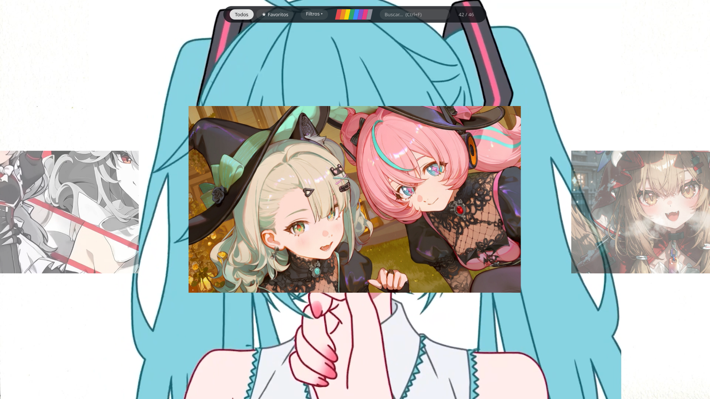
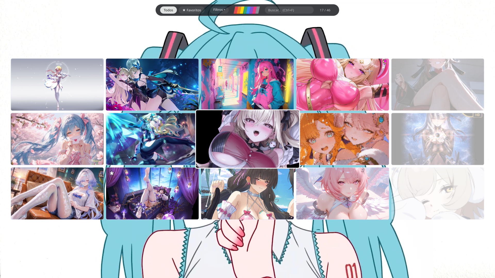
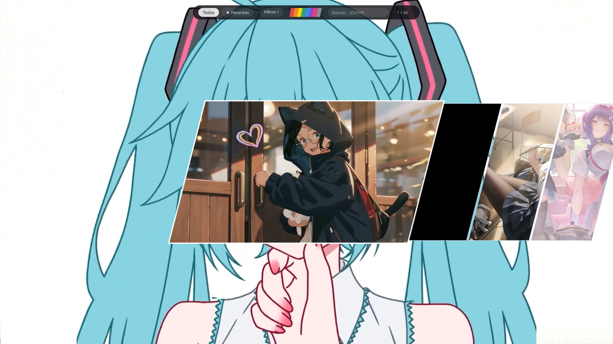
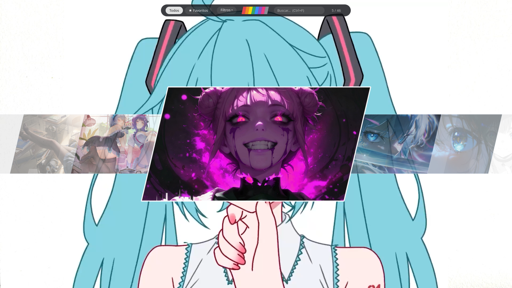

# Selectores de Fondos Animados

Dos selectores gráficos de fondos de pantalla animados para **Linux** (waywallen) y **Windows 10/11** (Wallpaper Engine o Lively Wallpaper), hechos con Python y PySide6:

| Selector circular | Selector hexagonal |
|---|---|
| Carrusel 3D de tarjetas rectangulares (16:9). | Panal de hexágonos dentro de un marco fijo e invisible; solo se mueven los hexágonos. |

## Capturas

| Circular | Hexagonal |
|---|---|
|  |  |

| Cuadrado | Tiras |
|---|---|
|  |  |

| Paralelogramo |
|---|
|  |

Los estilos cuadrado, tiras y paralelogramo, y la barra superior con favoritos y ocultar, están en [`selectores_personales/`](selectores_personales/LEEME.md) (archivos independientes).

> Las ilustraciones que se ven en las capturas pertenecen a sus autores y se muestran solo como ejemplo de la interfaz.

## Características

- Los dos diseños originales, conservados; comparten el mismo núcleo (no hay código duplicado).
- Fondos desde carpetas propias (vídeo `.mp4 .mkv .webm .avi .mov` e imagen `.jpg .jpeg .png .webp`) y desde **Wallpaper Engine** (carpetas de Steam y Workshop).
- Sistemas de aplicación, uno por plataforma, sin mezclarse:
  - Linux → **waywallen**
  - Windows → **Wallpaper Engine** (línea de comandos oficial) o **Lively Wallpaper** (línea de comandos oficial)
- **Modo oculto** protegido con contraseña (PBKDF2-HMAC-SHA256 con sal; sin contraseña por defecto; borrar o alterar sus datos bloquea, no restablece), con interruptor invisible `Ctrl+Shift+H`.
- Campo de contraseña minimalista: un rectángulo semitransparente, texto con puntos, sin botones.
- Configuración desde la propia interfaz (`F2`): rutas, sistema de fondos, contraseña. Nada de editar código.
- Volver al fondo anterior (`Ctrl+R` o `--restaurar`).
- Diagnóstico de dependencias (`--verificar`) con mensajes claros.

## Estado de compatibilidad (sé honesto con lo que está probado)

| Plataforma | Estado |
|---|---|
| Linux + waywallen (Bazzite/KDE Plasma, Wayland) | La lógica de comunicación viene del código que ya funcionaba en el equipo del autor. La versión reorganizada pasó las pruebas automáticas, **pendiente de una prueba real completa**. |
| Otras distribuciones Linux (Fedora, Ubuntu, Debian, Mint, Arch, Manjaro, openSUSE) | Instrucciones y script preparados; **sin probar** en esas distribuciones. |
| Windows 10/11 + Wallpaper Engine | Comando tomado de la documentación oficial; **sin probar en Windows real**. |
| Windows 10/11 + Lively | Comando tomado de la documentación oficial; **sin probar en Windows real**. |
| macOS | No soportado. |

Detalle en [`docs/PRUEBAS.md`](docs/PRUEBAS.md).

## Requisitos

- Python 3.9 o superior (recomendado 3.12).
- `PySide6` (y `websockets` en Linux): `requirements.txt`.
- **Linux:** [waywallen](https://github.com/waywallen/waywallen) en ejecución, `busctl` (systemd) y una sesión Wayland (X11 no está documentado por waywallen).
- **Windows:** Wallpaper Engine (Steam) **o** Lively Wallpaper.
- Opcional: `ffmpeg` para las miniaturas de los vídeos. No se necesita Docker ni Podman.

## Instalación rápida

**Linux**
```bash
git clone https://github.com/Saldivar-ctrl/Selectores-Fondos.git
cd Selectores-Fondos
bash scripts/instalar_linux.sh
.venv/bin/python src/main.py hexagonal
```

**Windows (PowerShell)**
```powershell
git clone https://github.com/Saldivar-ctrl/Selectores-Fondos.git
cd Selectores-Fondos
powershell -ExecutionPolicy Bypass -File scripts\instalar_windows.ps1
.\.venv\Scripts\python.exe src\main.py hexagonal
```

Guías completas: [Linux](docs/INSTALACION_LINUX.md) · [Windows](docs/INSTALACION_WINDOWS.md).

## Uso

```text
python src/main.py [circular|hexagonal]
python src/main.py --verificar      # revisa dependencias
python src/main.py --listar         # fondos que se mostrarían
python src/main.py --restaurar      # vuelve al fondo anterior
```

| Acción | Tecla / gesto |
|---|---|
| Mover | Arrastrar, flechas, `A` / `D`, rueda (hexagonal) |
| Aplicar el fondo | Clic o `Enter` |
| Configuración | `F2` |
| Modo oculto | `Ctrl+Shift+H` |
| Fondo anterior | `Ctrl+R` |
| Cerrar | `Esc` |

## Configuración

Se guarda fuera del código, en `~/.config/selectores-fondos/config.json` (Linux) o `%APPDATA%\SelectoresFondos\config.json` (Windows). Se edita desde `F2`. Referencia: [`docs/CONFIGURACION.md`](docs/CONFIGURACION.md).

## Documentación

- [Manual de usuario](docs/MANUAL_USUARIO.md)
- [Instalación en Windows](docs/INSTALACION_WINDOWS.md) · [en Linux](docs/INSTALACION_LINUX.md)
- [Configuración](docs/CONFIGURACION.md)
- [Solución de problemas](docs/SOLUCION_DE_PROBLEMAS.md)
- [Documentación técnica](docs/DOCUMENTACION_TECNICA.md)
- [Publicar en GitHub](docs/PUBLICAR_EN_GITHUB.md)
- [Pruebas realizadas y pendientes](docs/PRUEBAS.md)

## Pruebas

```bash
python -m unittest discover -s tests -v
```

## Licencia

MIT (ver [`LICENSE`](LICENSE)). PySide6 tiene su propia licencia (LGPL/GPL/comercial); revísala si distribuyes ejecutables. Wallpaper Engine, Lively y waywallen son programas independientes con sus licencias; este proyecto no los incluye.

## Créditos

- [waywallen](https://github.com/waywallen/waywallen) (MIT) — gestor de fondos animados para Wayland.
- [Wallpaper Engine](https://www.wallpaperengine.io/) — documentación de su [línea de comandos](https://help.wallpaperengine.io/en/functionality/cli.html).
- [Lively Wallpaper](https://github.com/rocksdanister/lively) — documentación de sus [controles de línea de comandos](https://github.com/rocksdanister/lively/wiki/Command-Line-Controls).

## Contribuciones

Los *issues* y *pull requests* son bienvenidos. Antes de enviar un cambio: ejecuta las pruebas, mantén la lógica fuera de las interfaces (`core/`, `platforms/`) y **di claramente en qué sistema probaste**. Si pruebas Windows u otra distribución, por favor reporta el resultado para actualizar `docs/PRUEBAS.md`.
